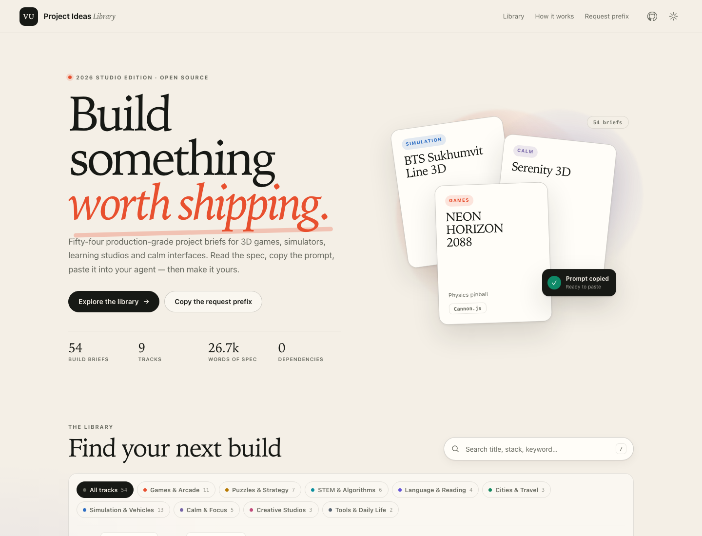

# VU Project Ideas

**54 production-grade build briefs. One searchable library. Copy the prompt, paste it into your agent, ship the project.**

[](https://somphol.github.io/vu_project_ideas/)
[](#deploy)
[](#whats-inside)
[](#verification)
[](LICENSE)



VU Project Ideas is a static, searchable library of project specifications for 3D games, simulators,
learning studios and calm interfaces. Each brief is a real, detailed task — not a one-line idea. Open
one, read the spec, copy the complete prompt, and paste it into OpenCode, Claude Code, Cursor or any
other coding agent.

It is **not** an app generator, a course, or a collection of finished products. Two briefs link to
older live builds as examples; the other 52 are specifications waiting for a build. There is no
backend, account, analytics, cookie or build step.

**Start here:** <https://somphol.github.io/vu_project_ideas/>

## What's inside

| Area | Count | What it does |
| --- | ---: | --- |
| Build briefs | 54 | Curated from 55 supplied blocks; one duplicate was merged |
| Tracks | 9 | Games, puzzles, STEM, language, cities, simulation, calm, craft, daily life |
| Specification | 26,748 words | Verbatim task bodies, not paraphrases |
| Copy-ready files | 54 | One Markdown prompt per brief in [`prompts/`](prompts/) |
| Live examples | 2 | US Map Jigsaw 3D and Word Practice |
| Runtime dependencies | 0 | Vanilla HTML, CSS and ES modules in the browser; Python only for the build |
| Local state | 2 keys | Shortlist and theme, both in `localStorage` |

Every card gives you a tagline, track, stack chips, brief size and a one-click **Copy** action. The
detail drawer adds the full prompt, a shortlist star, a `.md` download, a live-demo link when one
exists, and an “At a glance” view of the stack, features and prompt anatomy.

## Quick start

There is nothing to install for the site.

```bash
cd ~/Projects/vu_project_ideas
python3 -m http.server 4173      # http://127.0.0.1:4173/
npm start                        # the same server
```

Open the URL, search for “snooker”, “Bangkok”, “pinball” or “SRS”, then press **Copy**. The prompt is
already on your clipboard with the current request prefix attached.

## Use a brief

1. **Pick a brief.** Filter by track or stack, or search the full text of every specification.
2. **Press Copy.** You get the standard request prefix followed by the original task body.
3. **Paste it into your agent.** Replace any template tokens such as `[CITY_NAME]` first.
4. **Build it.** The prefix asks the agent for docs, a state file, verification, a GitHub release and
   a reusable skill — the same release discipline used to make this library.

The 54 Markdown versions live in [`prompts/`](prompts/README.md). They work on GitHub, in an editor,
or anywhere a clipboard is inconvenient.

## The request prefix

Every project in the original list repeated the same request wrapper. This repository keeps **one**
current version in [`data/prefix.txt`](data/prefix.txt) and substitutes the project title at copy time:

- create the project under `~/Projects`;
- push it to GitHub;
- avoid repeated Keychain prompts;
- record elapsed time, token usage and model credit in a state file;
- document everything another agent needs to reproduce it;
- include professional release docs;
- turn the work into a skill and publish a backup;
- minimise tokens without compromising quality.

Change that one file, run `npm run build`, and all 54 prompts and Markdown files update together.

## Data pipeline

```text
data/source.json    parsed source blocks (title, live URL, verbatim task)
data/metadata.json  curated title, tagline, track, aliases, duplicate markers
data/prefix.txt     the single current request prefix ({{TITLE}} placeholder)
        │
        ▼  python3 scripts/build.py
data/projects.js    browser payload: 54 projects + tracks + prefix
data/catalog.json   metadata-only feed, no task bodies
prompts/*.md        54 copy-ready prompt files + index
docs/CATALOG.md     generated catalog table
```

`data/projects.js` is the only data file the site loads. It is a classic script, not a `fetch`, so the
catalog also opens from `file://` and from any static host without CORS configuration.

To add or edit a brief, change `data/source.json` and `data/metadata.json`, then run:

```bash
npm run build
npm test
```

## Project layout

| Path | Purpose |
| --- | --- |
| `index.html` | Semantic shell: hero, catalog, filters, prefix section, credits, detail dialog |
| `assets/style.css` | Design tokens, light/dark themes, layout, cards, dialog, responsive rules |
| `assets/app.js` | Search, filters, sort, shortlist, theme, deep links, copy/download, dialog |
| `data/` | Source blocks, curated metadata, prefix, generated payload and catalog feed |
| `prompts/` | 54 Markdown prompts and an index |
| `docs/` | Architecture, reproduction, provenance, design, testing, deployment and policy docs |
| `scripts/build.py` | Rebuilds the payload, prompt files and catalog table |
| `scripts/verify.mjs` | Static release gate: data, prompts, site, docs, state, secret scan |
| `tests/browser.test.mjs` | Headless Chrome: 31 checks, screenshots, 390 px overflow test |
| `state.json` | Build record: elapsed time, token counters, verification, deployment, credits |

## Verification

```bash
npm test                 # static gate: data, prompts, docs, state, secret scan
npm run test:browser     # 31 headless Chrome checks + refresh assets/*.png
npm run verify           # both
```

The browser suite starts its own static server, uses a temporary Chrome profile with
`--use-mock-keychain`, drives the page over the DevTools Protocol, and checks search, track and stack
filters, shortlist persistence, the dialog, deep links, theme switching, desktop and 390 px layouts,
and zero console errors. It also rewrites the screenshots in `assets/`.

## Deploy

GitHub Pages serves `main` from the repository root. The site is plain files: no build step, no
Actions requirement, no environment variables.

```text
https://somphol.github.io/vu_project_ideas/
```

See [`docs/DEPLOYMENT.md`](docs/DEPLOYMENT.md) for the exact API commands, verification and rollback.

## Credits and license

Built in one [OpenCode](https://opencode.ai) session with **DeepSeek V4.1 Flash**
(`opencode-go/deepseek-v4.1-flash`). Elapsed time and token counters are recorded in
[`state.json`](state.json); the catalog's own build notes are in
[`docs/REPRODUCTION.md`](docs/REPRODUCTION.md).

The briefs are original project specifications supplied for this catalog. Code and documentation are
[MIT](LICENSE) © 2026 Somphol Boonjing. Third-party names and links remain the property of their owners;
see [`THIRD_PARTY_NOTICES.md`](THIRD_PARTY_NOTICES.md).
